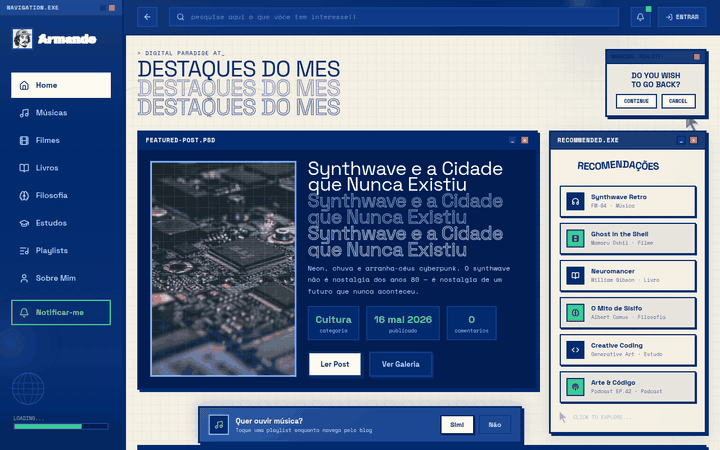
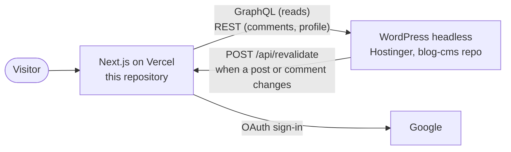

# Armando — art & digital technology

[](https://github.com/armandomonteir-o/armando-blog/actions/workflows/ci.yml)
[](./LICENSE)


Personal blog by Armando Monteiro about art and digital technology.

**Live:** [armando-blog.vercel.app](https://armando-blog.vercel.app)



<!-- Regravar o GIF quando o blog tiver mais posts, comentários e leituras: hoje ele mostra 6 posts, 0 comentários e traços nas leituras. -->

## The problem

A personal blog that is an editor's tool and a designer's canvas at the same time. Posts need to be written in a real CMS, with moderated comments and Google sign-in, but the page itself has to look like nothing a WordPress theme can produce: neobrutalism, retro-digital and Frutiger Aero, deliberately loud. So the CMS and the interface are separate. WordPress (headless, through WPGraphQL) only stores and serves content, and a Next.js app draws everything the visitor sees.

It is a portfolio project, built to show how the pieces fit and why each one was chosen, not to be a template. The "Decisions and trade-offs" section below has the reasoning, one line per decision.

**Where the interface came from:** the visual layer is a port. It started as a React (Vite) SPA prototype generated in Figma Make, and I migrated it to Next.js 16 with the App Router, server components and real data from WordPress. The work in this repository is that migration and everything behind the screens: the WPGraphQL data layer, Google sign-in, moderated comments and the CI.

**Design aesthetic**: Neobrutalism + Retro-digital + Frutiger Aero — intentional, non-negotiable.

**Stack**: Next.js 16 (App Router) · Tailwind v4 · TypeScript · Headless WordPress · WPGraphQL · Zustand

## How the pieces fit



The WordPress side (theme, plugin and deploy script) lives in the separate `blog-cms` repository. Hosting, domains, environment variables and deploy flow are in [`docs/ECOSYSTEM.md`](./docs/ECOSYSTEM.md).

## What is real data and what is still mock

| Route | Data |
|---|---|
| `/` (home) | **WordPress**, via WPGraphQL: the posts grid, the featured post (the pinned one, else the newest) and the latest approved comments, a section that stays hidden while there are none. The recommendations and the now-playing widget are fixed editorial content, and the "Ver Galeria" button is hidden until there is a gallery with an image. The newsletter widget is hidden until it really stores e-mails (`NEXT_PUBLIC_ENABLE_NEWSLETTER`, #112) |
| `/post/[slug]` | **WordPress**: the post (its body from the Gutenberg blocks, ADR-016), its comments and the related posts (same category). Reads and likes are not measured, so the page shows a dash |
| header search (every page) | **WordPress**, through `GET /api/search?q=` (the browser never asks WordPress): waits 300 ms after the last key, cancels the previous request, shows loading, no result and error, and works with the keyboard (#150) |
| comments, `/login`, `/minha-conta` | **WordPress** and Google OAuth |
| `/posts` | **WordPress**: all posts (up to 100, paginated and filtered in the browser). Like the home, it is built ahead of time, so a new post appears after the next deploy (#68) |
| `/categoria/...` | **WordPress**: which categories exist, their names and post counts, and the posts. The look of a category (colors, hero image, tags) is optional customisation in `data/categories.ts`; one without it gets a default look. A category the menu links to but WordPress doesn't have yet opens as an empty page, an unknown slug is a 404 ([ADR-015](./docs/adr/ADR-015-categorias-existem-no-wordpress-visual-no-codigo.md)) |
| `/playlists` | mock, and the page says so on screen |
| `/sobre` | **mock**: the bio, the skills, the timeline and the numbers on it (posts, views, comments) are fixed text written before the blog had content. Nothing on the page says so yet; reviewing it is #152 |
| `/sitemap.xml`, `/robots.txt` | **WordPress** for the sitemap (post slugs, categories and subcategories, plus the fixed routes), rendered on each request so a WordPress failure is a 500 that is never cached. `robots.txt` allows the site, blocks `/api/` and points to the sitemap. Absolute URLs come from `NEXT_PUBLIC_SITE_URL` (#12) |

## How fresh the content is

The home, `/posts` and each post are built ahead of time and rebuilt in the background at most once an hour (ISR). A new or edited post therefore shows up within an hour, with no deploy. Read-only calls to WordPress are retried up to three times on a passing network failure, so a blip does not break a build. Instant updates: WordPress tells the site when a post or comment changes (the `POST /api/revalidate` route, protected by `REVALIDATE_SECRET`, called by a hook in the `blog-cms` plugin), and the affected pages are rebuilt within seconds. If that call fails, the hourly rebuild still catches up. See [ADR-014](./docs/adr/ADR-014-cache-do-blog-isr-por-tempo-e-sob-demanda.md) and #68.

## When WordPress is down

The home never falls back to mock posts. If WordPress answers with no posts, the page says so. If WordPress fails:

- **at build time**, the build fails. On Vercel a failed build does not replace the deploy that is live, so visitors keep the last good version;
- **at request time** (for example `/post/[slug]`), the visitor sees the `ERRO.EXE` screen from `app/error.tsx`, with a retry button.
- **`/sitemap.xml`** is never built ahead of time, so it cannot fail a build: it answers 500 while WordPress is down, nothing is cached, and the next crawl works again.

On `/post/[slug]`, "WordPress answered that the post does not exist" is a 404, and "WordPress failed" is the `ERRO.EXE` screen. They are different on purpose: a post never turns into a 404 because of an outage.

For this reason CI builds against the real WordPress, through the `WORDPRESS_API_URL` repository variable (a public URL, not a secret). A red CI with `ENOTFOUND` means WordPress is unreachable, not that the code is broken.

## Decisions and trade-offs

One line each; the full context and the alternatives are in [`docs/adr/`](./docs/adr/).

| Decision | Why, and what it costs | ADR |
|---|---|---|
| Next.js 16 over Remix or Astro | Server components and ISR fit a mostly-read site; the cost is that Next 16 changes APIs often | [001](./docs/adr/ADR-001-nextjs-over-remix-astro.md) |
| Zustand over React Context | Global theme state that survives navigation, with no Provider wrapper and `localStorage` sync in a few lines; the cost is one small dependency | [002](./docs/adr/ADR-002-zustand-over-context.md) |
| WordPress as headless CMS | A real editor and moderation for free; the cost is hosting a PHP stack just for an API | [003](./docs/adr/ADR-003-wordpress-headless-cms.md) |
| WPGraphQL over the REST API | Ask for exactly the fields a page needs; the introspection is closed in production, so queries are validated by running them | [004](./docs/adr/ADR-004-wpgraphql-over-rest.md) |
| Tailwind v4 | The prototype already used v4, and going back to v3 would mean rewriting every utility class; the cost is a different, CSS-first configuration model | [005](./docs/adr/ADR-005-tailwind-v4.md) |
| Adapters from WordPress types to local types | Components never see the GraphQL shape. The silent mock fallback it first included was later removed, on purpose, so a demo never passes mock for real data | [006](./docs/adr/ADR-006-adapter-pattern-wp-to-local-types.md) |
| `databaseId` instead of the global `id` | Stable integer keys for React and the same ID as WP Admin and WP-CLI; the cost is exposing the database ID in the HTML and tying the field to WPGraphQL | [007](./docs/adr/ADR-007-databaseid-over-global-id.md) |
| Sign in with Google to comment, moderated in WordPress | Google OAuth only, so no passwords are stored; comments live in WordPress and are moderated in WP Admin. The cost is two server-side credentials: the Google session says who, the WordPress application password writes the comment | [009](./docs/adr/ADR-009-comment-auth-strategy.md) |
| Avoid ACF, prefer Gutenberg blocks | Content structure comes from Gutenberg blocks instead of plugin fields, after a plugin update broke every query once (ADR-008); the cost is that reading blocks still depends on a plugin or a parser of our own | [013](./docs/adr/ADR-013-evitar-acf-preferir-gutenberg.md) |
| Categories exist in WordPress, their look lives in code | The blog creates categories as it grows, with no deploy; changing how one looks does need a deploy | [015](./docs/adr/ADR-015-categorias-existem-no-wordpress-visual-no-codigo.md) |
| The post body comes from the Gutenberg blocks, through a plugin, sanitized | Headings, images, lists, quotes and code render as the author wrote them; the cost is third-party code installed from GitHub, outside wordpress.org | [016](./docs/adr/ADR-016-corpo-do-post-pelos-blocos-do-gutenberg.md) |
| Cache in two layers: ISR every hour plus on-demand revalidation | Pages are fast and static; WordPress pings the site, and the hourly rebuild covers a failed ping | [014](./docs/adr/ADR-014-cache-do-blog-isr-por-tempo-e-sob-demanda.md) |
| Request limit at the edge, not in code | One Vercel firewall rule limits `/api/comments`, `/api/profile` and `/api/search` to 30 requests per minute per IP (429 above it, proven in production). It needs no new service or dependency; the cost is that it is per IP, not per user, the same limit for the three routes, and the rule lives in the Vercel project, not in the repository | [018](./docs/adr/ADR-018-limite-de-requisicoes-na-borda-da-vercel.md) |
| Security headers now, the CSP only reporting | `nosniff`, referrer, permissions and anti-framing are on; the CSP is `Report-Only` and keeps `'unsafe-inline'`, because a nonce would make every page dynamic and lose the cache above. The cost is a weaker CSP, and nothing collects the reports | [017](./docs/adr/ADR-017-cabecalhos-de-seguranca-e-csp-em-modo-relatorio.md) |
| Public to read, not open source | The repository is public as a portfolio, under an all-rights-reserved license (it was MIT before). The cost: nobody can reuse the code without asking, and the repository does not take outside contributions | [019](./docs/adr/ADR-019-repositorio-publico-sem-licenca-aberta.md) |

## What is not done, and why

- **`/playlists` is still mock**, and it says so on screen. **`/sobre` is mock too**, with made-up numbers and no warning on screen, until the copy review (#152).
- **The category tree is minimal on purpose.** WordPress has only the categories the blog uses; the rest of the menu (Músicas, Filmes, Livros) opens as an empty page until there is something to put there.
- **The search is a plain WordPress search over published posts**: up to 5 results by title, no pagination and no results page. The notifications bell in the header is hidden (`NEXT_PUBLIC_ENABLE_NOTIFICATIONS`, off by default) because its content was sample text, not real notifications (#151).
- **Likes, notifications, replies and share buttons** were left out on purpose, to finish the blog first.
- **Reads and likes are not measured**, so the post page shows a dash instead of a made-up number.
- **The request limit is per IP, not per user** (#136, ADR-018), and the avatar upload only checks the 2 MB size, not the real file type.
- **The CSP is not enforced yet.** It ships as `Content-Security-Policy-Report-Only` until a real Google sign-in on production shows no violation in the browser console (#135).
- **No custom domain yet.** The target addresses and the order of the migration are in [`docs/ECOSYSTEM.md`](./docs/ECOSYSTEM.md).

## Getting started

```bash
nvm use          # switches to node 22 via .nvmrc
npm install
npm run dev      # http://localhost:3000
```

`WORDPRESS_API_URL` must be set in `.env.local`, pointing to the WPGraphQL endpoint. `NEXT_PUBLIC_SITE_URL` (the public address, used by the sitemap and `robots.txt`) is optional and defaults to `https://armando-blog.vercel.app`.

## Tests

```bash
npm test                          # unit tests, offline
SMOKE_TEST=1 npm test             # also checks the published site: pages, 404, login, revalidate guard, sitemap, headers
SMOKE_TEST=1 SMOKE_URL=https://<preview>.vercel.app npm test   # same, against a preview
WP_LIVE_TEST=1 npm test           # also checks the queries against the real WordPress schema and runs the
                                  # comment moderation flow (needs WP_APP_USER and WP_APP_PASSWORD; it creates
                                  # a test comment and always deletes it)
# Comment route with a session made inside the test, no Google (needs a local server with the same throwaway secret):
AUTH_SECRET=<throwaway> npm run dev -- -p 3010
ROUTE_TEST_URL=http://localhost:3010 ROUTE_TEST_AUTH_SECRET=<same throwaway> npm test
```

### Dependencies in CI

CI runs `npm audit --omit=dev --audit-level=high` before everything else: a "high" or "critical" advisory in what ships to production turns it red. Development-only dependencies run the same audit as a warning, because tooling does not ship and an advisory with no fix would otherwise block every PR. Dependabot (`.github/dependabot.yml`) opens weekly PRs for npm and GitHub Actions, with minor and patch updates grouped in one PR and each major on its own. How to handle those PRs is in [`docs/DEVELOPMENT.md`](./docs/DEVELOPMENT.md).

A scheduled workflow (`.github/workflows/smoke.yml`, every hour and by hand from the Actions tab) runs the smoke test against production, retries once after 90 s, and only then opens one issue (or comments on the open one); it closes the issue when the test passes again (#131, details in [`docs/ECOSYSTEM.md`](./docs/ECOSYSTEM.md)).

The smoke test exists because login once returned 500 in production for weeks with a green build: the Auth.js variables were missing from Vercel (#91). Run it after changing environment variables or redeploying.

## Documentation

All technical documentation lives in [`/docs`](./docs/):

- [`ECOSYSTEM.md`](./docs/ECOSYSTEM.md) — hosting, domains, accounts and deploy flow
- [`DEVELOPMENT.md`](./docs/DEVELOPMENT.md) — how work is done here: branches, commits, checks, Dependabot and `npm audit`
- [`ARCHITECTURE.md`](./docs/ARCHITECTURE.md) — layout system, routing, scroll behavior
- [`DESIGN-SYSTEM.md`](./docs/DESIGN-SYSTEM.md) — colors, typography, CSS variables, dark mode
- [`DATA-MODELS.md`](./docs/DATA-MODELS.md) — TypeScript interfaces, WP/ACF mapping
- [`MIGRATION-GUIDE.md`](./docs/MIGRATION-GUIDE.md) — step-by-step migration plan
- [`COMPONENTS.md`](./docs/COMPONENTS.md) — component catalog with data dependencies
- [`adr/`](./docs/adr/) — architecture decision records
- [`pitfalls/`](./docs/pitfalls/) — known gotchas and non-obvious behavior
- [`learnings/`](./docs/learnings/) — study notes on the techniques used here

To report a vulnerability, see [`SECURITY.md`](./SECURITY.md), at the repository root where GitHub looks for it.

## Repository structure

```
app/           Next.js App Router (pages and layouts)
components/    Shared React components
lib/           GraphQL client, queries, adapters, WordPress helpers, design tokens
store/         Zustand stores
constants/     Shared lookup tables (categoryColors, navigation) and the mock post list
data/          Mock content for the routes not yet on WordPress
styles/        CSS custom properties and global styles
docs/          Project documentation
```

## Reference prototype

The Figma Make prototype this interface was ported from lives in `Neobrutalist Art Blog Homepage/` (gitignored, local reference only). All visual decisions are derived from it. Do not change any styling without consulting it.

## License

All rights reserved. The repository is public so it can be read and evaluated, but it is not open source and does not accept outside contributions. See [`LICENSE`](./LICENSE) and [ADR-019](./docs/adr/ADR-019-repositorio-publico-sem-licenca-aberta.md).
